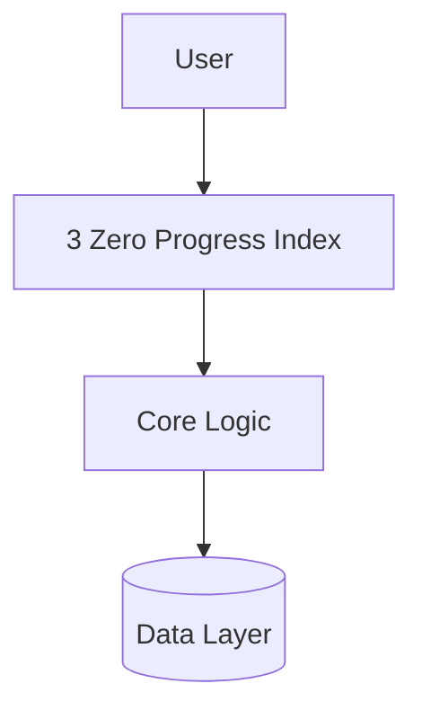

# CLAUDE.md — 3 Zero Progress Index

> AI memory file for `3zero`. Generated 2026-06-15. Prefer accuracy over assumptions; verify against code before major changes.

## Project Overview

| Field | Value |
|-------|-------|
| **Project name** | 3 Zero Progress Index |
| **Path** | `D:\Workflow\3zero` |
| **Purpose** | Policy-relevant composite index for Bangladesh sustainable development. |
| **Problem solved** | Need quantified progress tracking for 3 Zero goals. |
| **Target users** | Policy researchers, ICENS audience. |
| **Current status** | active |
| **Maturity** | Paper in development |
| **Completion** | ~75% |

## Elevator Pitch

Bangladesh 3 Zero Movement composite index (3ZPI) — poverty, unemployment, carbon. Built with Python, pandas, wbgapi, LaTeX. Status: active, ~75% complete.

## Business Context

- **Why it exists:** Policy-relevant composite index for Bangladesh sustainable development.
- **Alternatives:** See sibling projects in `D:\Workflow\WORKFLOW_INDEX.md`
- **Competitive advantages:** Same author track as researchonthego, math
- **Long-term vision:** Reach production maturity and document in portfolio-4

## Technical Architecture

research-notes/code/analysis.py + World Bank/OWID data

## Repository Structure

research-notes/{data,code,drafts,methods}/, output/

## Technology Stack

| Technology | Role | Why chosen |
|------------|------|------------|
| Python | Primary stack | Standard for this project type |
| pandas | Primary stack | Standard for this project type |
| wbgapi | Primary stack | Standard for this project type |
| LaTeX | Primary stack | Standard for this project type |

## Data Model

Inspect schema files: `prisma/schema.prisma`, `shared/schema.ts`, SQL migrations, or `data/` CSV/JSON as applicable.

## API Documentation

For web/API projects: list routes in `server/routes.ts`, `main.py` FastAPI app, or `src/app/api/` Next.js routes. Run codebase search for `@app.get`, `router.`, or `export async function`.

## Core Features

### Working
- Abstract at 18th ICENS Dec 2025
- Regression, correlation, min-max normalization

### Partial / Missing
- Full paper completion
- knowledge-os project doc

## Workflows

- **Dev setup:** Read README in project root
- **Build/test:** Follow package.json scripts or Makefile
- **Deploy:** Not deployed — see ROADMAP.md

## Known Issues

### Bugs
- None documented — audit before release

### Technical debt
- See PROJECT_STATE.md

## Future Roadmap

See `ROADMAP.md`. Quick tiers:
- **Easy:** README polish, env example, lint fixes
- **Medium:** Missing features from PROJECT_STATE.md
- **Major:** Production deploy, test coverage, architecture refactor

## Contribution Guide

- **Safe files:** Docs, tests, config examples, UI copy
- **Risky files:** Auth, migrations, native/C++ IME engines, production configs
- **Testing:** Run project test suite before PR; dry-run for destructive tools (e.g. sortinghat)

## Debugging Guide

1. Read `PROJECT_STATE.md` for known broken areas
2. Check env vars (.env.example)
3. For Android: `./gradlew assembleDebug` and logcat
4. For Python: `pytest` in project root

## AI Development Instructions

1. Read this file + `AI_CONTEXT.md` first
2. Do not change unrelated code; match existing conventions
3. Update PROJECT_STATE.md when completing features
4. Cross-check `D:\Workflow\MASTER_CONTEXT.md` for ecosystem links

## Resume Value

Skills: Python, pandas, wbgapi, LaTeX. Scores — Resume: 8/10, Recruiter: 7/10.

## Project History Reconstruction

- Initial scaffold → feature development → current active state (~75%)
- See `CHANGELOG_SUMMARY.md` and git log: `git -C "D:\Workflow\3zero" log --oneline -20`

## Health Score (6/10 avg)

| Dimension | Score |
|-----------|-------|
| Architecture | 6/10 |
| Maintainability | 8/10 |
| Scalability | 6/10 |
| Security | 5/10 |
| Documentation | 8/10 |
| Portfolio value | 8/10 |

## Related Projects

- Same author track as researchonthego, math

---
*GitHub:* https://github.com/minhaj14d/3zero · *Deploy:* None
